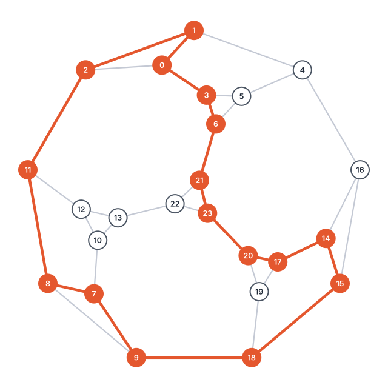

<div align="center">

# Erdős–Gyárfás Conjecture Explorer

**Does every graph with minimum degree 3 contain a cycle of length 4, 8, 16, 32, …?**

An exact power-of-two cycle checker, a verified construction of the Markström graph,
a test suite that checks every claim against brute force and the literature,
and a 10-page paper on the conjecture.

**[📄 Read the paper (PDF)](paper/erdos-gyarfas.pdf)**

[](https://github.com/DenWick/erdos-gyarfas/actions/workflows/tests.yml)
[](https://github.com/DenWick/erdos-gyarfas/actions/workflows/paper.yml)


[](LICENSE)

<picture>
  <source media="(prefers-color-scheme: dark)" srcset="figures/markstrom-dark.svg">
  
</picture>

<sub>The Markström graph: 24 vertices, every vertex of degree 3, no cycle of length 4 or 8.
Highlighted: a cycle of length 16, the reason it is <i>not</i> a counterexample.</sub>

</div>

---

## The problem

In 1995, Paul Erdős and András Gyárfás conjectured (published by Erdős in 1997; [Erdős Problem #64](https://www.erdosproblems.com/64)):

> Every graph in which each vertex has at least 3 neighbours contains a cycle whose length is a power of two.

It is easy to state and still open. The degree bound is tight: an odd cycle has minimum degree 2 and no power-of-two cycle at all.

What is known:

| Result | Source |
|---|---|
| True for 3-connected cubic planar graphs | Heckman & Krakovski, 2013 |
| A counterexample needs at least 17 vertices | Royle & Markström (computer search) |
| A *cubic* counterexample needs at least 30 vertices | Royle & Markström (computer search) |
| The smallest cubic graphs with no C₄ and no C₈ have 24 vertices; exactly one of them is planar | Markström, 2004 |

That planar one is the **Markström graph** shown above. It dodges the two smallest powers of two, but it still has a 16-cycle.

## What this repository does

```console
$ python -m erdos_gyarfas markstrom --spectrum
============================================================
  markstrom
============================================================
  vertices: 24   edges: 36   min degree: 3
  C4    none
  C8    none
  C16   found   0 -> 1 -> 2 -> 11 -> 8 -> 7 -> 9 -> 18 -> 15 -> 14 -> 17 -> 20 -> 23 -> 21 -> 6 -> 3 -> 0
  cycle lengths: [3, 5, 6, 7, 9, 10, 11, 12, 13, 14, 15, 16, 17, 18, 19, 20, 21, 22, 23, 24]

  -> conjecture holds for this graph
```

- **Exact search with witnesses.** For each power of two `k ≤ n`, it either prints an actual `k`-cycle you can check by hand or proves none exists.
- **Any graph you like.** Pass a named graph (`markstrom`, `petersen`, `heawood`, `k4`, `cube`, `c7`) or a text file with one `u v` edge per line. The exit code is non-zero only if it finds a counterexample.
- **The Markström graph, derived rather than copied.** [`scripts/derive_markstrom.py`](scripts/derive_markstrom.py) rebuilds it from a structural description (K₄ with three vertices replaced by a 7-vertex gadget and one by a triangle). It searches every possible wiring and finds exactly one cubic planar graph with no C₄ or C₈. Its full cycle spectrum matches the published one.
- **Crossing-free drawing.** [`scripts/draw_markstrom.py`](scripts/draw_markstrom.py) uses Tutte's barycentric embedding to produce the figure above.

## Quick start

```bash
git clone https://github.com/DenWick/erdos-gyarfas.git
cd erdos-gyarfas
pip install -e ".[dev]"

python -m erdos_gyarfas                        # Markström, Petersen, K4, C7
python -m erdos_gyarfas graphs/markstrom.txt   # any edge-list file
python -m erdos_gyarfas petersen --spectrum    # every cycle length
pytest                                         # 52 tests
```

The checker itself uses only the standard library. `networkx` is needed only for the planarity test and the scripts.

## How the search works

To find a cycle of length `k`, the checker runs a depth-limited backtracking DFS from each vertex `s`. It only steps to vertices larger than `s`, so every cycle is found from exactly one starting point: its smallest vertex. It tracks the current **path**, not a global visited set. A visited set would explore a single DFS tree and miss most cycles.

Deciding whether a `k`-cycle exists is NP-complete in general: `k = n` is the Hamiltonian cycle problem. So the worst case is exponential. For the graphs in this project, with up to a few dozen vertices, every query finishes in milliseconds.

## Testing

The test suite checks that:

- the Markström graph is cubic with 24 vertices and 36 edges, is planar, and has no C₄ or C₈ but does have a C₁₆;
- its full cycle spectrum equals `{3, 5, 6, 7, 9, …, 24}`, as listed on MathWorld;
- K₄, K₅, Petersen, Heawood, the 3-cube and C₇ have their known cycle spectra;
- on 40 random small graphs, the result matches a brute-force search over every vertex subset and ordering;
- every reported witness is a genuine cycle of the claimed length.

## Why this was a Formal Languages project

Write the cycle lengths of a graph in unary. The conjecture then asks whether a set of words must meet the language L = { a^(2^k) : k ≥ 2 }.

L is not regular. Its lengths are not eventually periodic, and the pumping lemma breaks it directly. So a finite automaton cannot recognize the target set, and that rules out a whole family of "finite-state" arguments. This connection is what took the problem from a graph theory question to an automata course.

## The paper

[`paper/`](paper) holds the LaTeX source of the accompanying paper, [*The Erdős–Gyárfás Conjecture: Cycles of Power-of-Two Length, the Markström Graph, and Computational Approaches*](paper/erdos-gyarfas.pdf). It covers:

- the history of the problem and the known partial results;
- a proof that minimum degree 3 forces an even cycle, and why that argument cannot reach powers of two;
- an explicit construction of the Markström graph, drawn in TikZ;
- the search algorithm and how it is tested;
- the link to formal languages.

GitHub Actions compiles it on every change. To build it locally, run `cd paper && latexmk -pdf main.tex`.

## Project layout

```
src/erdos_gyarfas/
  graph.py           Graph class, edge-list loader
  cycles.py          exact cycle search, spectrum, power-of-two report
  named_graphs.py    Markström, Petersen, Heawood, K_n, cube, odd cycle
  __main__.py        command-line interface
tests/               pytest suite (incl. brute-force cross-check)
scripts/             derivation of the Markström graph, figure generation
graphs/              example edge-list files
figures/             generated SVGs (light and dark)
paper/               LaTeX source and compiled PDF
```

## References

- P. Erdős, *Some old and new problems in various branches of combinatorics*, Discrete Mathematics 165–166 (1997), 227–231. [doi:10.1016/S0012-365X(96)00173-2](https://doi.org/10.1016/S0012-365X(96)00173-2)
- C. C. Heckman, R. Krakovski, *Erdős–Gyárfás conjecture for cubic planar graphs*, Electronic Journal of Combinatorics 20(2) (2013), #P7. [doi:10.37236/3252](https://doi.org/10.37236/3252)
- K. Markström, *Extremal graphs for some problems on cycles in graphs*, Congressus Numerantium 171 (2004), 179–192.
- [Erdős Problem #64](https://www.erdosproblems.com/64), the conjecture's entry in the Erdős problems database.
- [Markström Graph](https://mathworld.wolfram.com/MarkstroemGraph.html), MathWorld.

---

<sub>Started as a course project for Formal Languages and Automata, Faculty of Mathematics and Computer Science, University of Bucharest (2026). Author: Denis-Alexandru Ionescu-Telibasa.</sub>
